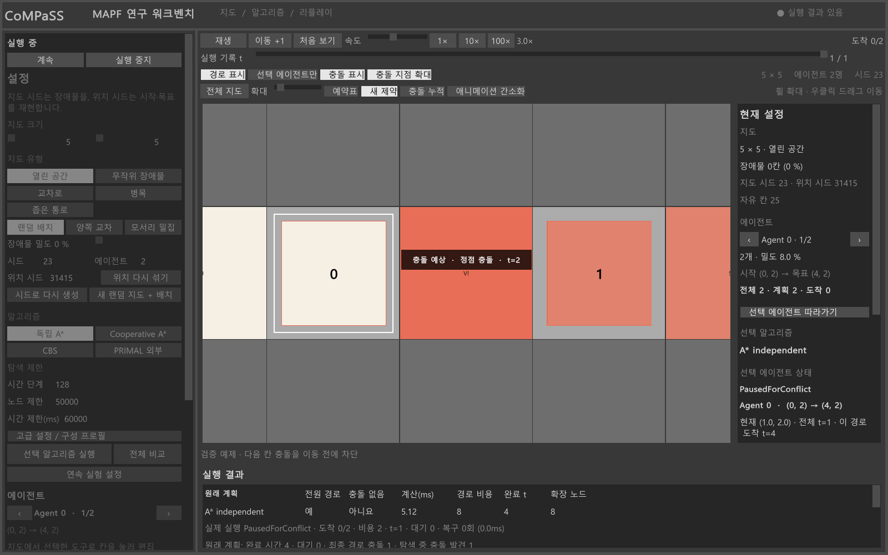
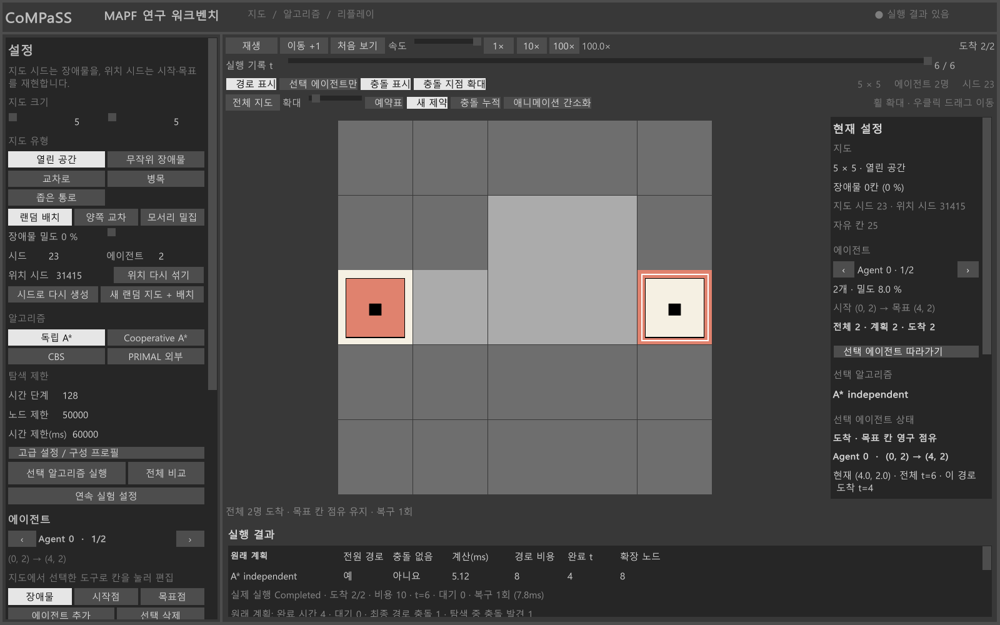
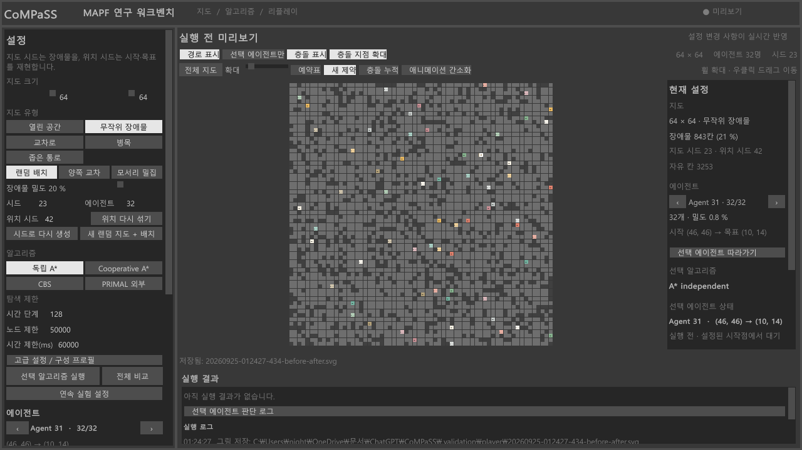

# CoMPaSS 전체 구현 기록

기준일: **2026-09-25 (KST)**  
대상: 최초 MAPF 개발 명세서와 이후 UI·충돌 복구·연속 실험·보고서 관련 요청  
환경: **Unity 6000.4.0f1 / Windows / C#**

## 1. 완료 상태

프로젝트 내부에서 실행하는 지도·에이전트 편집, A*/Cooperative A*/CBS, DG/WDG, 안전한 이동과 자동 복구, CBS 과정 재생, 연속 실험, 구성 프로필, 비교·통계·보고서 기능을 구현했습니다. 최신 코드를 실제 Unity 프로젝트에 반영했고 Windows 프로그램을 빌드·실행했습니다.

**PRIMAL은 공개 모델 연결 코드와 환경 구성 안내까지 구현했습니다. 학습 체크포인트와 호환 TensorFlow 환경은 포함하지 않으며, 실제 학습 모델 추론은 미검증입니다.** 사용자가 보유 모델이 없다고 답한 데 따라 공개 모델을 연결하는 경로를 제공했습니다. 규칙 기반 알고리즘을 PRIMAL 추론으로 표시하지 않습니다.

원래 명세에서 선택 사항이었던 자체 재학습, Jobs/Burst 최적화, 알고리즘 생성 AI는 이번 완료 범위에 넣지 않았습니다. 무제한 크기·무제한 탐색 또는 모든 문제의 해결 성공을 보장하지 않습니다.

## 2. 파일과 실행 위치

| 산출물 | 위치 |
|---|---|
| 실제 Unity 프로젝트 | `C:\Users\night\OneDrive\Desktop\CoMPaSS\CoMPaSS` |
| 코드·문서 작업 폴더 | `C:\Users\night\OneDrive\문서\ChatGPT\CoMPaSS` |
| 검증한 Windows 프로그램 | 작업 폴더의 `Builds/Windows/CoMPaSS.exe` |
| 사용 설명서 | [README.md](README.md) |
| 원본 명세 사본 | [Docs/요구사항.md](Docs/요구사항.md) |
| 지도·설정·작은 비교 결과 예제 | [Samples](Samples/README.md) |
| 공개 PRIMAL 연결 방법 | [Tools/Primal/README.md](Tools/Primal/README.md) |
| 보존한 검사 결과·실행 화면 | `Docs/Verification/` |

Unity에서는 **Play → Game**으로 실행합니다. Scene 편집 화면에 지도나 UI가 없는 것은 실행 시 워크벤치를 만드는 구조 때문입니다. 실행 파일을 배포할 때는 `Builds/Windows` 폴더 전체가 필요합니다.

## 3. 요구 기능별 구현 내역

### 3.1 지도와 에이전트

| 요구 기능 | 구현 내용 |
|---|---|
| 지도 너비·높이 입력 | 각 4–64, 입력 중 문자열 보존, Enter·포커스 해제 후 적용 |
| 절차적 생성 | 열린 공간, 무작위 장애물, 교차로, 병목, 좁은 통로 |
| 지도 랜덤 생성 | 시드 재생성 및 새 시드 지도·배치 생성 |
| 배치 랜덤 생성 | 지도 유지 후 위치만 섞기, 별도 배치 시드 |
| 배치 분포 | 무작위, 양쪽에서 마주 오는 배치, 모서리 집중 배치 |
| 병목 조절 | 병목 수·통로 폭, 연속 실험의 목록 입력 |
| 수동 편집 | 장애물 추가·삭제, 선택 에이전트 시작·목표 변경 |
| 에이전트 관리 | 1–32명, 고유 ID, 추가·삭제·선택, 전체 수와 계획된 수 별도 표시 |
| 연결 검사 | BFS 연결 성분으로 시작→목표 도달 가능성 검사 |
| 유효한 자동 배치 | 시작·목표 중복 방지, 같은 연결 영역에 배치, 필요할 때 연 칸 수 기록 |
| JSON 재현 | 장애물 좌표, 실제 배치, 생성 시드와 설정을 함께 저장 |

요청 장애물 밀도와 실제 장애물 밀도는 다를 수 있습니다. 에이전트를 배치할 공간 확보를 위해 벽을 열었다면 그 수를 기록합니다. 시작·목표가 연결되어 있다는 사실만으로 여러 에이전트의 충돌 없는 공동 해를 보장하지 않습니다.

### 3.2 UI와 시각화

| 요구 기능 | 구현 내용 |
|---|---|
| 중립적인 색상 | 회색·흰색 기반 패널과 컨트롤, 에이전트 식별·충돌에 제한된 포인트 색상 |
| 파란 기본 스킨 제거 | normal/hover/active/focused/selected 상태별 스타일 명시 |
| 글꼴 개선 | Windows 맑은 고딕 우선, 대체 글꼴·명시적 크기 지정 |
| 에이전트 수 증가 시 잘림 | 전체 목록 대신 선택기로 전환, 설정·상태·결과의 독립 스크롤 |
| 실시간 미리보기 | 적용된 크기·유형·밀도·시드·인원·분포를 즉시 반영 |
| 확대·이동 | 휠, 확대 슬라이더, 우클릭 드래그, 전체 지도 복귀 |
| 선택 에이전트 추적 | 마커 클릭·선택기로 지정하고 경로·상태·판단 표시 |
| 이동 보간 | 검증된 다음 위치로만 보간, 간소화 모드 지원 |
| 많은 에이전트 표시 | 경로 없는 에이전트도 유지, ID·선택 외곽선, 도착 마커 |
| 충돌 강조 | 정점/간선 구분, 충돌 시점·에이전트 표시, 자동 확대와 설명 정지 |
| 연구 오버레이 | 시간별 예약·간선, 새 제약, 충돌 누적 구역, 선택 경로 |
| 초심자 안내 | 사용 순서·지표 설명·연결 검사·계산 부담 경고 |

1280×720에서 32명 미리보기와 1600×1000에서 충돌·완료 화면을 실제 플레이어로 캡처했습니다. 모든 상세 정보를 동시에 펼치는 대신 각 패널의 스크롤과 접기를 사용합니다. Unity Game 뷰를 확대 표시하면 에디터 자체의 표시 배율 때문에 흐려질 수 있으므로 원본 화면 확인은 배율 1×가 적합합니다.

### 3.3 알고리즘

| 알고리즘 | 구현 내용 |
|---|---|
| 독립 A* | 4방향 최단 경로, 맨해튼/유클리드/0 휴리스틱, 가중치, 이웃 순서, 동률 처리 |
| Cooperative A* | 공간·시간 탐색, 정점/역방향 간선 예약, 대기, 목표 영구 점유 |
| 우선순위 판단 | 입력 순서·먼 거리·거리/혼잡/협소 가중 점수, 요소별 설명 |
| 복구 시 적응형 판단 | 누적 대기와 충돌 관여 기록을 반영하는 우선순위 가중치 |
| CBS | 충돌 탐지, 두 제약 분기, 해당 에이전트 재탐색, 상위 비용 순서 |
| DG/WDG | 에이전트 쌍의 추가 비용 탐색, 의존 그래프, 정수 정점 덮개 하한 |
| 공통 인터페이스 | `IMapfSolver`, 공통 입력 설정과 `MapfRunSummary` |
| 중단·제한 | 취소 토큰, 전체 계산 시간·탐색 노드·시간 창 제한, 실패 이유 |

#### DG/WDG의 정확한 범위

초기의 단순 충돌 그래프 매칭만 사용하던 구현을 보완했습니다. 현재는 현재 제약하에서 두 에이전트의 최적 추가 비용을 보조 CBS로 구하고, DG에는 의존 관계 1, WDG에는 추가 비용을 사용합니다. 가중 정점 덮개를 탐색하며, 제한에 걸리면 허용적인 매칭 하한을 사용합니다.

- 쌍별 탐색: 최대 2,000개 상위 노드·100ms 및 전체 실행 제한 이내
- 정점 덮개: 최대 100,000개 탐색 상태·40ms 및 전체 실행 제한 이내
- 결론이 나지 않은 쌍: 기여 0
- 정확 계산 또는 하한 대체 여부와 쌍별 가중치: 로그 기록

제한이 없는 표준 알고리즘의 성질을 유한 제한 실행 전체에 그대로 주장하지 않습니다. 작은 2에이전트 문제에서는 완전 열거한 공동 상태 탐색 결과와 기본 CBS/DG/WDG의 최적 비용을 대조했습니다. 하위 탐색 제한에 걸린 분기를 버린 채 최적 해라고 표시하지 않도록 실패 처리를 보완했습니다.

### 3.4 CBS 시행착오와 리플레이

- 상위 노드 ID·부모 ID·비용, 발견 충돌, 새 제약, 재탐색 대상과 성공·실패를 기록합니다.
- 생성한 제약 분기의 시도까지 프레임으로 저장합니다.
- 탐색 프레임 선택·이전/다음·연속 재생과 최종 이동 재생을 구분합니다.
- 제약 적용 전후 경로를 비교 그림으로 내보냅니다.
- 탐색 기록은 JSON에 저장·복원합니다.
- 연속 실험에서는 메모리를 줄이기 위해 상세 CBS 프레임 수집을 끕니다. 개별 실행에서 전체 과정을 확인할 수 있습니다.

CBS 제약 트리 프레임은 상위 탐색의 시행착오를 뜻합니다. 각 하위 A*의 모든 열린 목록 상태를 프레임별로 저장하는 기능은 포함하지 않습니다.

### 3.5 안전한 실행과 자동 복구

```text
경로 계산 → 다음 공동 이동 검사 → 정상 이동 → 도착 칸 점유 유지
                     ↓ 충돌 / 미계획 / 잘못된 이동
                  전원 정지
                     ↓
        현재 위치에서 대안 계획·검증 → 재개
                     ↓ 실패 / 제한
              안전 정지 + 원인·로그 저장
```

1. 부분 계획이 나와도 원래 에이전트 정의와 현재 위치를 모두 유지합니다.
2. 미계획 에이전트는 제자리에 남아 점유합니다.
3. 정점 중복, 반대 방향 간선 통과, 벽·비인접 이동을 커밋 전에 검사합니다.
4. 이미 도착한 에이전트는 이후 위치를 변경하지 않으며 복구 지도에서도 장애물로 취급합니다.
5. 우선순위 유지·역순·회전 등의 대안을 시도하고 선택적으로 CBS를 사용합니다.
6. 대안은 ID·시작·목표·이동·충돌 검사를 통과한 경우에만 적용합니다.
7. 이미 이동한 실제 경로의 접두부를 보존하고 새 경로를 이어 붙입니다.
8. 정지·대안 시도·실패·재개·도착을 시간, 방법, 소요 시간, 경로 전후 상태와 함께 남깁니다.

실행 상태는 Ready, Moving, PausedForConflict, Replanning, Completed, Failed, Cancelled로 분리했습니다. 자동 복구를 끄면 충돌 전에 정지합니다. 복구 횟수는 1–50, 실행 전체는 최대 4,096단계로 제한합니다.

### 3.6 연속 실험·통계·구성 도구

| 기능 | 구현 내용 |
|---|---|
| 알고리즘 고정 실험 | 동일 알고리즘·프로필로 크기·에이전트 수·밀도·병목 수/폭·반복 시드 조합 |
| 시나리오 전환 | 사례 종료 후 결과 저장 → 다음 사례 자동 실행 |
| 중단·재개 | 현재 작업 취소, 완료 사례 보존, 미완료 사례부터 다시 실행 |
| 체크포인트 | 임시 JSON 작성 후 교체, 이전 버전 `.bak` 유지 |
| 고배속 | 최대 100×, 프레임당 여러 논리 단계를 검사하며 처리 |
| 동일 조건 비교 | 현재 지도·실제 배치를 복사하여 세 C# 알고리즘 실행 |
| 구성 프로필 | 휴리스틱·가중치·이웃 순서·동률·대기·우선순위·계산 제한 저장 |
| 요소 제거 비교 | 고정 순서, 전체 가중치, 혼잡 제외, 협소 제외, 거리 제외 |
| 결과 보존 | 비교별 자체 설정 스냅샷, 이름·수치·판단 로그 저장 |
| 통계 | 같은 조건별 평균·모분산·표준편차·최솟값·최댓값·P95·실패 수 |
| 비교 그래프 | 계획 시간 막대, 에이전트 수와 시간 산점도, 성공/복구/실패 구분 |

지도 유형과 시작·목표 분포는 캠페인 시작 시 고정합니다. 해당 두 조건을 바꾸려면 별도 캠페인을 시작합니다. 한 캠페인은 최대 2,000사례이며, 비교 통계는 알고리즘·크기·인원·밀도·병목·분포·프로필이 같은 조건끼리 묶습니다.

계획 시간은 실패한 실행을 포함해 집계합니다. 실제 비용·대기·완료 단계 통계는 성공한 실행만 사용하여 실패한 부분 경로가 평균을 부당하게 낮추지 않도록 했습니다. 성공 사례가 없으면 해당 수치는 빈칸입니다.

### 3.7 기록과 보고서용 이미지

- 설정·장애물·배치·원래 경로·CBS 프레임·우선순위·판단 로그 JSON
- 실제 실행 경로, 충돌·재계획 전후 경로, 복구 방법·시간 JSON
- 알고리즘·요소 제거 비교 CSV와 비교별 설정 JSON
- 연속 실험 원시 CSV, 조건별 통계 CSV, 차트 SVG
- UI 화면 2× PNG: 원본 화면이 매우 큰 경우 1×로 제한
- 지도 PNG: 화면 해상도에 의존하지 않는 별도 래스터 렌더링
- 지도 SVG: 벡터 경로·ID·시작/목표·설명·캡션
- CBS 제약 또는 복구 전후, 알고리즘 비교를 같은 배율의 PNG/SVG로 저장
- 사용자 메모·캡션 보조 파일·최근 이미지 목록·Windows 클립보드 복사
- HTML 상세 보고서와 Markdown 진입 문서, CSV/JSON/그림을 같은 폴더에 저장

원래 계획과 실제 이동 기록을 구분합니다. 저장한 시나리오 옆의 실제 실행 JSON이 있으면 검증 후 이력을 재생합니다. 보고서에 이미 저장된 캠페인의 마지막 사례를 중복 집계하지 않도록 처리했습니다.

PNG 지도에는 숫자와 S/G 표시를 넣고 긴 한글 캡션은 보조 텍스트와 SVG에 보존합니다. 보고서에서 확대·편집할 그림은 SVG를 사용할 수 있습니다.

### 3.8 공개 PRIMAL 연결

`Tools/Primal/primal_adapter.py`는 원저자 저장소의 ACNet과 관측 생성 함수를 불러와 체크포인트를 복원하도록 작성했습니다.

- stdin/stdout 한 줄 JSON 프로토콜, stderr 진단 로그
- 별도 Python 프로세스, 시간 제한·취소·종료 처리
- 원본의 4채널 10×10 관측, 목표 벡터, 5개 행동 확률·선택 행동 반환
- 에이전트별 recurrent state, 시드와 argmax 정책 선택
- 목표 점유·공동 정점/간선 충돌 검사, 충돌 전 rollout 중단
- 모델 출처와 체크포인트 **인덱스 파일** SHA-256 기록
- 잘못된 ID, 좌표, 이동, 목표 이탈 경로 거부
- 실패 응답의 관측·판단 로그 유지

모델 관측이 없는 화면의 국소 지도는 재구성 관측이라고 표시하여 실제 정책 입력과 구분합니다. 제공 어댑터의 동시 이동·목표 점유 규칙은 원저자 순차 이동 데모와 실행 조건이 다르므로 논문 수치와 직접 동일시할 수 없습니다.

현재 검증은 Python 문법과 설정 파일이 없을 때의 명시적인 JSON 실패 응답까지입니다. 공개 체크포인트 다운로드·TensorFlow 환경 설치·실제 모델 추론은 이 PC에서 수행하지 않았습니다. `environment.yml`은 호환 환경 구성안이며 검증 완료된 환경 이미지가 아닙니다.

## 4. 주요 버그 수정 기록

| 문제 | 수정 |
|---|---|
| 32명으로 A* 후 Cooperative 실행 시 일부만 보임 | 부분 경로 목록과 전체 에이전트 목록 분리, 누락 경로는 제자리 점유 |
| 도착 에이전트 통과 | 최종 칸 영구 예약, 미래 예약과 도착 시점 검증, 복구에서 벽 처리 |
| 처음부터 목표인 에이전트가 나중 순서라 통과됨 | 계획 순서와 무관하게 미리 고정 점유 예약 |
| 충돌 장면이 잘 느껴지지 않음 | 이동 전 전체 정지, 충돌 종류·시점·당사자와 확대·전후 비교 |
| 100배속에서 충돌 검사 누락 가능 | 모든 논리 단계마다 검사 후 커밋, 보간도 승인된 이동만 사용 |
| 숫자 10 입력 중 최소값 4로 바뀜 | 편집 문자열 버퍼와 확정 값 분리, 확정 후 범위 적용 |
| 에이전트가 많으면 패널이 길어짐 | 고정 선택기와 독립 스크롤, 목록 길이와 지도 레이아웃 분리 |
| 기본 Unity 스킨의 파란 잔상 | 컨트롤의 모든 상태와 배경 텍스처 명시 |
| 복구 후 타임라인이 오래된 기록 표시 | 실제 실행 단계 변경 시 재생 경로 캐시 갱신 |
| 완료 메시지가 파일 저장 안내를 계속 덮음 | 최초 완료 전환에서만 상태 안내 변경 |
| 중지 후 비교 결과를 선택하면 취소 상태 유지 | 새 실행용 취소 토큰 생성, 해당 결과의 설정 복원 |
| 요소 제거 비교 파일의 설정이 다른 결과와 섞임 | 결과마다 깊게 복사한 설정 스냅샷 저장 |
| 병목 지도 아래로 우회하는 틈 | 벽을 연속 생성하고 지정 폭의 통로만 개방 |
| 부분 CBS 프레임 저장 시 null 경로 예외 | 누락 경로를 허용하는 안전한 직렬화 |
| 시드 0 저장·불러오기 불일치 | 0도 유효한 시드로 유지 |
| 불러오기 실패 후 예전 이력 사용 | 성공 여부를 확인한 뒤 관련 이력 로딩 |
| CBS 하위 제한 분기를 버리고 성공 처리 | 제한 원인을 전파하고 허위 최적 성공 방지 |
| 실패한 짧은 실행이 비용 평균을 낮춤 | 비용 계열은 성공 실행만 집계, 실패 수 별도 |
| 보고서에 캠페인의 마지막 사례 중복 | 저장된 사례와 현재 실행의 동일성 확인 |
| 실행 직후 캡처가 검은 화면 | Unity 시작 화면 종료 후 캡처, 빈 이미지 검사 |
| 표의 숫자 의미와 복구 비용 혼동 | 원래 계획 열 제목과 실제 실행 비용·시간·대기 별도 표시 |

## 5. 소스 구조

| 위치 | 책임 |
|---|---|
| `Assets/Scripts/Core` | 격자·좌표·에이전트·경로·지도 생성·연결 검사 |
| `Assets/Scripts/Algorithms` | A*, Cooperative, CBS, DG/WDG, 충돌 검사, 프로필, PRIMAL 브리지 |
| `Assets/Scripts/Experiment` | 공통 결과·계획 실행·시뮬레이션·복구·연속 실험·통계·메모리 표본 |
| `Assets/Scripts/Persistence` | 시나리오·리플레이 JSON, CSV, 보고서 SVG |
| `Assets/Scripts/UI/MapfWorkbenchController.cs` | 런타임 생성·레이아웃·지도·입력·선택 상태 |
| `MapfWorkbenchExecution.cs` | 비동기 계산·취소·이동·복구·캠페인 체크포인트 |
| `MapfWorkbenchResearch.cs` | 구성 도구·비교·예약·제약·관측·불러오기 |
| `MapfWorkbenchReports.cs` | PNG·SVG·클립보드·보고서 폴더 |
| `MapfWorkbenchVerification.cs` | 명시적인 진단 인수가 있을 때만 실행하는 플레이어 검사 |
| `Assets/Editor/MapfBuild.cs` | Unity 메뉴·배치 모드 Windows 빌드 |
| `Tools/Regression` | 순수 C# 검사, 독립 JSON 대체 구현, 작은 완전 탐색 기준 |
| `Tools/Primal` | 공개 모델용 Python 어댑터·환경 구성·설정 예제 |

기존 Unity `.meta`, 씬과 에셋 참조는 보존했습니다. `Library`, `Temp`, `Logs`를 직접 수정하지 않았습니다. Unity가 가져오기·빌드 과정에서 생성하는 캐시만 사용했습니다.

## 6. 실제 검증 결과

### 6.1 순수 C# 회귀 검사

**통과: 88,902개 assertion / 실제 시뮬레이션 44사례.**

`python Tools/validate_core.py`로 설치된 .NET 10 SDK의 참조 어셈블리를 사용했습니다. NuGet 다운로드가 필요하지 않습니다. 독립 JSON 대체 구현은 검사 도구에서만 사용하며 Unity Assets에 포함하지 않습니다.

- A* 휴리스틱·이웃 순서·동률 처리 24개 조합의 단순 최단 비용
- 정점/반대 간선 충돌, 한 단계씩 이동, 목표 점유 불변식
- 목표 도착 전에 미래 예약을 모두 확인하는 Cooperative 동작
- 시작=목표 에이전트가 마지막 계획 순서인 경우
- 전체 32명 중 부분 경로 5개가 있어도 32명 유지
- 충돌 정지→복구→재개, 복구 전 실제 이력 보존
- 해결 불가능한 맞교환과 제한 도달 시 안전 실패
- CBS 제약 시도 프레임, 상세 기록 끄기
- 기본 CBS/DG/WDG와 4개 시드의 작은 공동 상태 완전 탐색 최적 비용 대조
- JSON 시드 0·null 경로·로그·우선순위·프로필 스냅샷 보존
- 연속 실험 조합·결정적 배치·조건 오류·취소 토큰
- 병목 수·폭·좁은 통로·시작/목표 분포·연결성
- CSV 이스케이프·소수점 문화권 독립성·SVG XML 유효성
- 예제 파일 생성과 재로딩

36개 무작위 사례는 12×12, 4/8/16/32명, 시드 0/23/921, 세 알고리즘으로 실행했습니다. 이 중 일부는 1.2초·600개 상위 노드 등 검사 제한 안에서 해를 얻지 못합니다. 이는 기록된 실패 결과이며 모든 사례의 도착 성공을 뜻하는 검사 통과가 아닙니다. 검사는 실패 상황에서도 잘못된 이동·충돌·에이전트 누락이 없는지 확인합니다.

추가 검사 실행 중 한 번 .NET 프로세스가 대기 상태에 머물러 해당 검사 프로세스만 종료했습니다. 도구에 180초 제한과 파일 로그, 예외 출력을 추가한 뒤 재실행하여 위 결과를 얻었습니다.

결과: [core-results.txt](Docs/Verification/core-results.txt)

### 6.2 Unity 컴파일·Windows 실행

- 설치된 **Unity 6000.4.0f1** 참조로 전체 런타임 스크립트 컴파일 통과
- 실제 프로젝트의 씬·패키지를 사용한 Windows 64비트 빌드 성공, 종료 코드 0
- 빌드한 실행 파일에서 명시적인 진단 모드 실행, 종료 코드 0
- 마주 오는 2명: t=1에서 다음 정점 충돌 차단 → 대안 계획 → 2명 모두 도착
- 지도 PNG/SVG와 충돌 복구 전후 PNG/SVG 실제 파일 생성
- 1280×720에서 64×64 지도·32명 미리보기 생성 및 화면 확인
- 8×8/10×10 × 2명/4명의 총 4사례: 시작→중지→이어하기→4개 결과 저장, 알고리즘 유지 확인
- 캡처가 빈 이미지인지 검사, Unity Error/Exception/Assert 로그 수집

결과: [player-check.txt](Docs/Verification/player-check.txt), [player.log](Docs/Verification/player.log)

종료 시 `GarbageCollector disposing of ComputeBuffer` 경고 1건이 남습니다. 프로젝트의 사용자 코드에는 ComputeBuffer 생성이 없으며 렌더링 종료 경로에서 출력됩니다. 프로그램 실행 오류는 수집되지 않았지만 이 엔진/렌더링 자원 정리 경고를 해결했다고 주장하지 않습니다.

### 6.3 실제 화면

충돌을 다음 이동 전에 차단한 화면:



복구 후 도착과 원래 계획·실제 실행 수치:



1280×720의 32명 미리보기:



### 6.4 검증하지 않은 항목

- 실제 PRIMAL 체크포인트 추론, 원저자 환경과의 정확한 행동 일치
- Windows 클립보드를 Word/PowerPoint 등 여러 외부 앱에 붙여 넣는 전체 호환성
- 모든 해상도·DPI·그래픽 드라이버·다른 PC 조합
- 2,000사례 최대 캠페인의 장시간 연속 부하
- 전체 HTML 보고서의 모든 외부 브라우저·인쇄 엔진 호환성
- 모든 MAPF 인스턴스의 완전성·최적성에 대한 형식 증명

## 7. 연구 결과 해석과 남은 조건

1. **원래 계획 성공**: 모든 에이전트 경로를 얻었고 최종 경로 간 충돌이 없음.
2. **실행 성공**: 안전 정지·다른 알고리즘 복구를 포함해 모두 도착함.
3. 원래 계획 시간·복구 시간·경로 비용·실행 비용은 별도 수치입니다.
4. g/h/f 표시와 실제 경로는 선택 설정을 따릅니다. 가중치 1 초과 A*는 최단성 보장이 없습니다.
5. 메모리는 전체 프로세스 관리 힙의 표본 최고값이며 알고리즘 단독/GPU/Python 최대 메모리가 아닙니다.
6. 고정 시드의 지도·배치는 재현됩니다. 시간 제한 직전 탐색 중단 시점은 컴퓨터 부하에 따라 달라질 수 있습니다.
7. 새로운 가중 우선순위 방식과 요소 제거 비교 도구는 제공하지만, 기존 알고리즘보다 우수하다는 일반적인 연구 결론은 아직 내리지 않았습니다. 제공 CSV는 실제 작은 예제 측정값입니다.
8. Burst DLL 오류 4551의 Windows 정책 원인을 이 작업에서 확정하지 않았습니다. 이번 빌드는 Burst 비활성화 옵션으로 성공했고 Windows 보호 설정은 변경하지 않았습니다.

### 원래 선택·제외 범위

| 항목 | 처리 |
|---|---|
| PRIMAL 자체 학습·재학습 | 명세의 선택 항목. 학습 파이프라인·학습 결과 미포함 |
| Jobs/Burst 최적화 | 병목 측정 뒤 검토하는 선택 항목. 현재 순수 C# 계산 |
| 알고리즘 생성 AI/LLM | 선택 연구 확장. 외부 API·모델 미연결 |
| Joint A* | 제품 알고리즘으로 미노출. 작은 검사 기준에만 공동 상태 완전 탐색 사용 |
| 임의 C# 컴파일·실행 | 명세의 제외 범위 유지 |
| 로봇 물리·3D·센서 오차 | 명세의 제외 범위 유지 |

## 8. 참고 자료

- 공개 PRIMAL 연결 대상: [원저자 PRIMAL 저장소](https://github.com/gsartoretti/PRIMAL). 모델 출처와 오래된 실행 환경 요구를 확인하는 기준입니다.
- DG/WDG 상위 휴리스틱: [Improved Heuristics for Multi-Agent Path Finding with Conflict-Based Search, IJCAI 2019](https://www.ijcai.org/proceedings/2019/0063.pdf). 프로젝트는 유한 보조 탐색과 안전한 하한 대체를 적용한 자체 구현입니다.

이 문서는 실제 소스·검사·빌드 결과를 기준으로 작성했습니다. 외부 모델이 필요한 기능이나 선택 연구 항목을 검증 완료한 기능으로 합치지 않았습니다.

## 9. 2026-09-30 UI 탭 구성과 가독성 개선

- 한 화면에 섞여 있던 설정·실행·결과를 시작·프리셋, 실험 설정, 실행·리플레이, 결과, 사용법의 다섯 탭으로 분리했습니다.
- 프리셋은 상황 설명과 함께 보여주고, 선택하면 실험 설정으로 이동합니다. 실행 버튼은 화면 아래에 고정해 설정 목록을 스크롤해도 접근할 수 있게 했습니다.
- 탭 전환 중 시뮬레이션, 리플레이 위치, CBS 탐색 상태는 유지합니다. 설정 입력 중 다른 탭으로 이동할 때 숫자 필드를 먼저 확정합니다.
- 실행 결과, 연속 실험 요약, 충돌·복구 로그와 SVG/PNG/CSV/JSON/HTML 내보내기를 결과 탭에 모았습니다. 사용법 탭에는 시작 순서, 알고리즘 설명, 지도 조작과 범례를 추가했습니다.
- 파란색 중심 UI 색상을 차콜 그레이와 회색 표면으로 바꾸고, 성공·주의·충돌에는 차분한 녹색·앰버·코랄 포인트를 적용했습니다.
- 전체 화면 GUI 변환 행렬 축소를 제거하고 DPI 또는 화면 높이 기준으로 글꼴 크기를 조정했습니다. 작은 화면은 설정과 미리보기를 위아래로 배치하며 탭별 스크롤을 제공합니다. 기존 고해상도 PNG와 SVG 지도 내보내기는 유지했습니다.
- 이 UI 수정에 대한 Unity 컴파일, 플레이 모드, 스크린샷 확인은 아직 수행하지 않았습니다.
